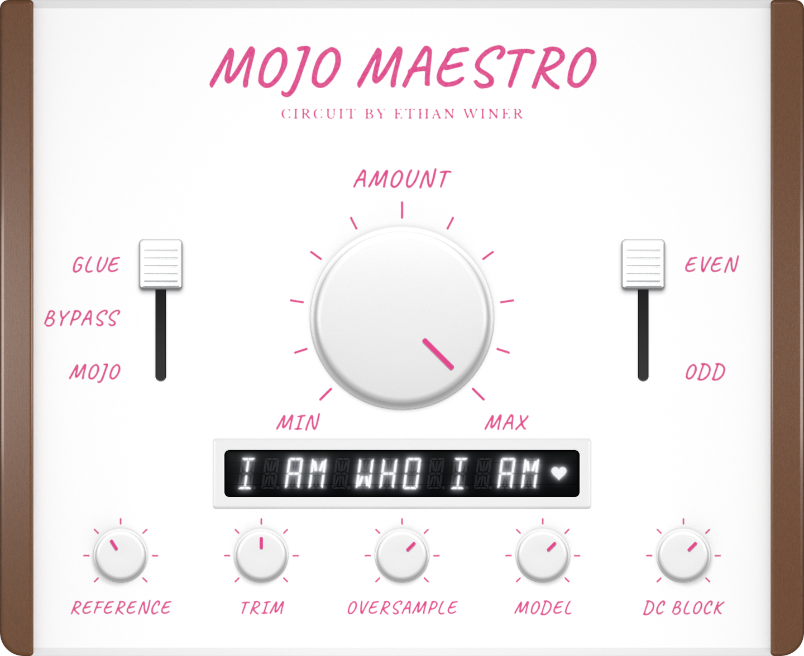

# Mojo Maestro VST3

A stereo VST3 plugin, built with JUCE 9, that emulates the passive diode
clipper "Mojo Maestro" designed by Ethan Winer. The distortion comes from the
circuit's topology, not from a generic soft-clip curve: the resistor and diode
loop is solved for every sample.

The plugin has its own window, a photographic faceplate with a knob, two
slide switches, five small knobs and a white vacuum-fluorescent display (see "The window" below).

## Credit

The circuit is Ethan Winer's. It was published in *audioXpress*, October 2017
("Mojo Maestro"). This project is an independent software emulation. It is
not made, endorsed or supported by Ethan Winer, and it contains none of the
article text, schematic drawing, photographs or artwork of the hardware unit.
The 1N270 diode limits used in the tests come from the Microsemi 1N270
datasheet, cited here by name only.

## The circuit being modelled (per channel)

- R1 = 1 kOhm from input to output node A.
- D1 (1N270, germanium) always connected across A and B; clips negative peaks.
- D2 (1N270) in series with a switch from A to B; connected for "Odd", which
  clips positive peaks too.
- From B: R2 = 1 kOhm (Glue) or R3 = 120 Ohm (Mojo), then a 10 kOhm linear pot
  used as a rheostat (Amount; "More" = 0 Ohm).
- C1 = 0.047 uF from A to ground, in circuit only in Mojo mode.
- Centre-off switch position is a true bypass.
- Passive: output level falls as distortion rises. There is no makeup gain.

## The window

The window opens at 720 x 588 (the design is 480 x 392, shown at 1.5x) and keeps that shape. The artwork is stored at 3x, so it stays sharp on 200 % displays. Drag the
lower-right corner to resize it from 360 x 294 up to 1440 x 1176; the picture
scales with it.

Drag the big Amount knob right or up for more (MIN is at the lower left, MAX at the lower
right). The left slide switch is Mode: Glue at the top, Bypass in the middle, Mojo at the
bottom. The right one is Harmonics, Even on top and Odd below. Click or drag a cap to move it.
Reference and Trim are the first two small knobs, dragged up or down. Oversample, Model and
DC Block step to the next setting on each click.

Double-click Amount, Reference or Trim to return it to its default. The mouse
wheel also turns those three knobs. Drags are sent to the host as proper
gestures, so automation records them correctly.

The display under the big knob is a vacuum-fluorescent style readout with
13 sixteen-segment characters in white, and a small heart on the right.
Unlit segments stay faintly visible, a fine honeycomb mesh lies over the glass,
and the lit segments glow. While nothing is being touched it alternates every
7 seconds between two messages. The first holds "GLORY TO I AM", then steps
along one character at a time to "I AM WHO I AM", at which point the heart
lights. The second shows the credit line. While a control is held, hovered or
just released (1.5 seconds) the display shows that control's name on the left
and its value on the right (for example `TRIM -6.0 DB` or `MODEL COUPLED`),
then the alternating messages resume.

### How the faceplate is made

The faceplate is not drawn by code. It is a set of pictures: the white powder-coat plate with pink silkscreen lettering, the walnut end cheeks, the white plastic display bezel, the round white knobs and the pink knob pointers are rendered in Blender (Cycles) with real geometry; the slide channels, the display's smoked-glass window and the cleaned-up ribbed switch cap are made by the Python scripts in `art/pipeline`.
They are stored at three times the design size in `Assets`, embedded in the
plugin with `juce_add_binary_data`, and drawn scaled to the window. The
pointer pictures point up and are turned to the knob's angle by the code. The
soft shadow under each pointer and the whole display (unlit segments, mesh,
lit segments, glow, filament wires) are drawn by code. The segment shapes and
the letter table come from one script, `art/pipeline/vfd_geometry.py`, which
writes `Source/VfdGeometry.h`.

- `Assets/` holds the six pictures the plugin embeds.
- `art/` holds the Blender scene scripts, the layout numbers (`layout.json`),
  the silkscreen masks and the picture pipeline. `art/README.md` explains how
  to regenerate everything. Blender is needed only for the renders.

## Requirements

- Visual Studio 2026 with "Desktop development with C++" (toolset v145)
- CMake 4.2 or newer (first version with the `Visual Studio 18 2026` generator)
- JUCE 9.x (9.0.5 tested), fetched automatically or supplied by you

Blender is needed only to re-render the faceplate pictures, not to build the
plugin.

## Build

    cmake --preset vs2026
    cmake --build --preset release

Output: `build\MojoMaestro_artefacts\Release\VST3\Mojo Maestro.vst3`

Use an existing JUCE checkout instead of downloading one:

    cmake --preset vs2026 -DMOJO_JUCE_DIR=C:/JUCE

The built plugin passes the validator from Steinberg's VST3 SDK (47 of 47
tests) and pluginval at strictness level 10.

## Parameters

| Name | Range | Default | Notes |
|---|---|---|---|
| Mode | Bypass / Glue / Mojo | Glue | Glue = 1 kOhm; Mojo = 120 Ohm plus the C1 rolloff |
| Harmonics | Even / Odd | Even | Even = D1 only; Odd = D1 + D2 |
| Amount | 0..1 | 1.0 | 1 = "More". The circuit is never fully clean, like the hardware |
| Input Reference | 0.1..8 V | 1.24 V | Volts at 0 dBFS. Diodes turn on at an absolute voltage, so this sets drive |
| Output Trim | -24..+24 dB | 0 dB | Manual level matching |
| Oversampling | Off / 2x / 4x / 8x | 4x | Linear-phase. The reported latency is fixed (the 8x figure) so every setting is time-aligned |
| Circuit Model | Simple / Coupled | Coupled | Coupled solves C1, R1 and the diodes together at one node |
| DC Block | on/off | on | 5 Hz high-pass; Even mode creates a DC offset |

Mode, Harmonics and Circuit Model changes crossfade over about 10 ms, and an
Oversampling change over about 20 ms. Changes that arrive together or while a
fade is running are crossfaded one after the other, so nothing steps or clicks.

## Tests

The DSP engine is a single header, `Source/MojoMaestro.hpp`, and its tests
need no JUCE:

    cl /std:c++17 /EHsc /O2 /I Source dsp_tests\test_datasheet.cpp
    cl /std:c++17 /EHsc /O2 /I Source dsp_tests\test_coupled.cpp

(or `g++ -std=c++17 -O2 -ISource dsp_tests/test_datasheet.cpp`). The datasheet
test checks that the diode model respects the 1N270 limits (forward voltage at
most 1.00 V at 200 mA, leakage at most 100 uA at 50 V), that Bypass is exact,
that silence stays silent, and that the DC output matches an independent
solution of the circuit equation. `DESIGN.md` describes the model and what
was checked.

The plugin itself (processor and editor) has three offline test programs:

    cmake --preset vs2026 -DMOJO_BUILD_TESTS=ON
    cmake --build --preset release --target Mojo_click_test Mojo_interaction_test Mojo_snapshot_test

- `Mojo_click_test` runs the processor on a sine and checks that no setting
  change (alone, together or overlapping) and no start of playback makes a
  click.
- `Mojo_interaction_test` drives the editor with mouse events and checks what
  each control does.
- `Mojo_snapshot_test` paints the editor to PNG files (idle messages, the
  scrolling step and every control's read-out) and checks that the display text
  is lit in each state and that the heart is lit only at the end of the first
  message.

## Known limits

- The diode saturation current, ideality factor and series resistance are
  estimates chosen to fit the datasheet limits. They have not been measured on
  a real 1N270.
- The output is modelled as open circuit; Winer's own test used a 10 kOhm load.
- The faceplate is a fixed picture: it scales with the window but its layout
  does not change.
- Not yet verified in every host. Reports are welcome.

## Licence

GNU Affero General Public License v3.0, see `LICENSE`. JUCE is used under its
AGPLv3 option.

The lettering on the faceplate picture was set in Caveat (title and control
labels) and Libre Baskerville (the two small lines under the title). Both fonts
are under the SIL Open Font License 1.1. Neither font is included in this
repository or embedded in the plugin; the display is drawn from
its own sixteen-segment shapes.